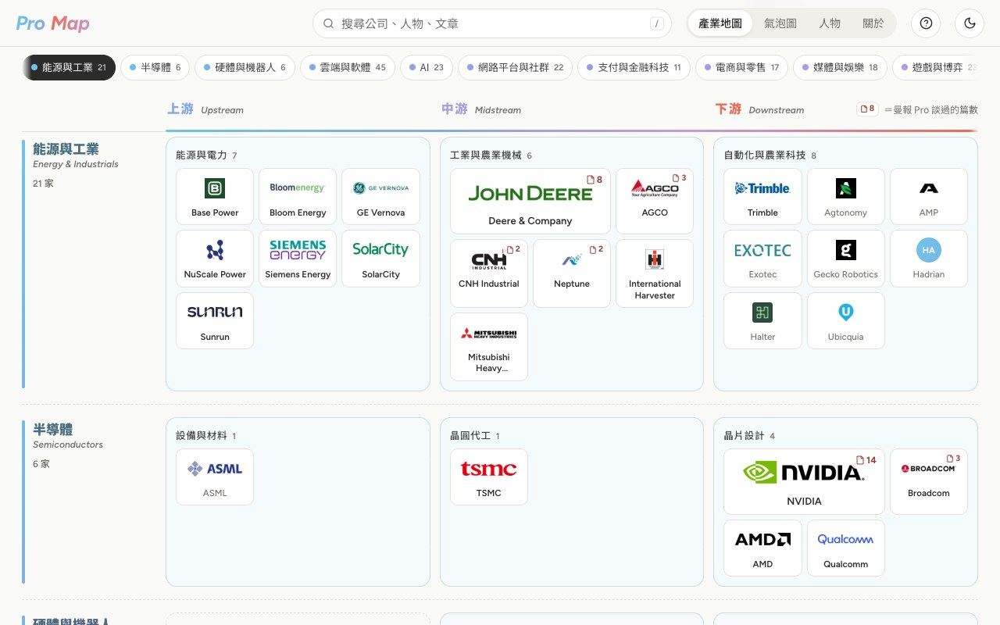

# Pro Map｜曼報公司地圖

Pro Map 是曼報讀者維護的非官方索引。用公司、人物或文章標題找回曼報談過的主題，再沿著上下游、投資和收購關係探索相關公司。

**[開啟公司地圖](https://aiwlulu.github.io/manny-pro-map/)** · [使用導覽](https://aiwlulu.github.io/manny-pro-map/guide) · [更新紀錄](CHANGELOG.md)

[](https://aiwlulu.github.io/manny-pro-map/)

## 怎麼用

- **找文章與節目**　搜尋公司、人物或文章標題。公司卡會列出收錄的曼報 Pro 文章、Pro Podcast 和公開曼報 Podcast，點標題即可前往原站。
- **看一家公司**　例如開啟 [NVIDIA 公司卡](https://aiwlulu.github.io/manny-pro-map/#/c/nvidia)，查看關鍵人物、相關文章、營收結構和資料來源。
- **沿著產業鏈探索**　從產業地圖選一家公司，查看上下游與資金關係。也可以切換到[氣泡圖](https://aiwlulu.github.io/manny-pro-map/#/bubbles)，瀏覽公司在各產業的分布。
- **從人名回找內容**　在[人物索引](https://aiwlulu.github.io/manny-pro-map/#/people)查看人物與公司的關聯，或依「巨人之聲」欄目篩選。

## 資料來源

網站索引收錄標題、日期和原站連結。公司簡介與關係以官網、財報等公開資料為基礎，圖片授權與來源標在公司卡或人物頁。

Pro Map 與曼報（Manny Li）無隸屬關係。完整文章與節目請到曼報原站閱讀或收聽，可從[曼報 Pro 訂閱頁](https://pro.manny-li.com/join)或[曼報 Pro 免費導覽](https://tour.manny-li.com/index.html)開始。

## 在本機執行

使用 Node.js 22（與 CI 相同）。

```bash
npm ci
npm run dev
```

`npm run dev` 會產生網站資料並啟動本機預覽。只需驗證資料和建置網站時，執行 `npm run build`。

## 回報問題與貢獻

歡迎[開 issue](https://github.com/aiwlulu/manny-pro-map/issues/new)回報職稱、公司關係或連結錯誤。附上公司或人物名稱，以及可核對的公開來源，方便維護者確認。

公司資料放在 `data/companies/`，每家一個 YAML。文章與節目的索引放在 `data/sources.yaml`。新增或修改資料前，請參閱[貢獻指南](CONTRIBUTING.md)。

## 授權

- 程式碼採 [MIT](LICENSE)。
- 社群撰寫的資料採 [CC BY 4.0](LICENSE-DATA.md)。
- 曼報文章與節目著作權屬於原作者。圖片依個別標示的來源與授權使用，商標僅供識別。
